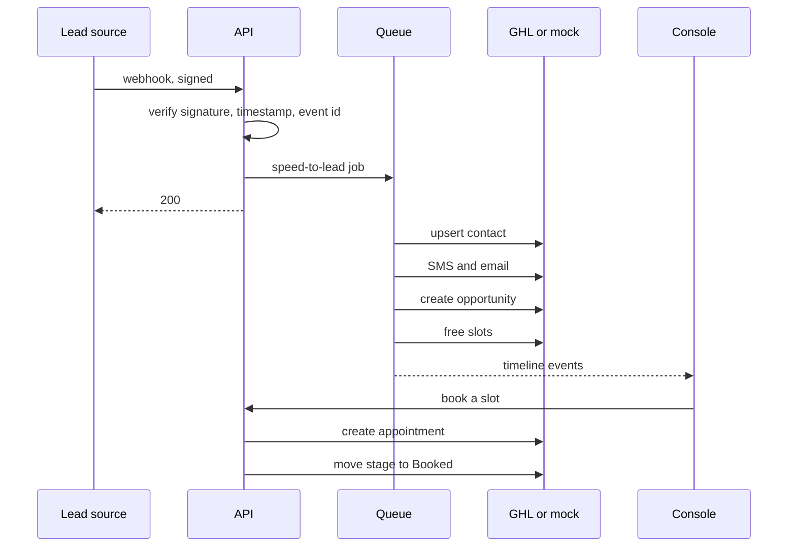
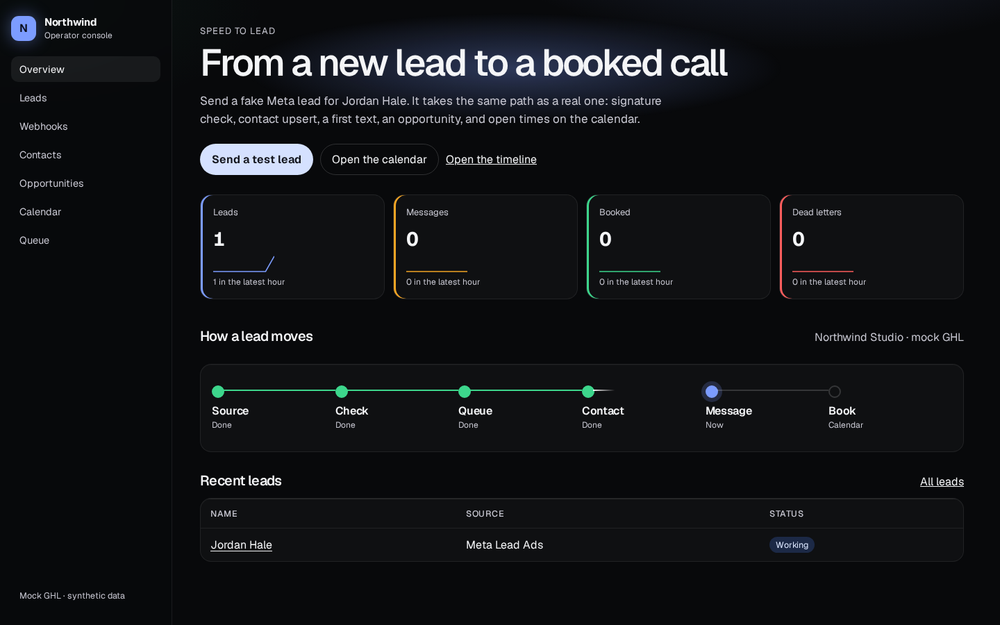
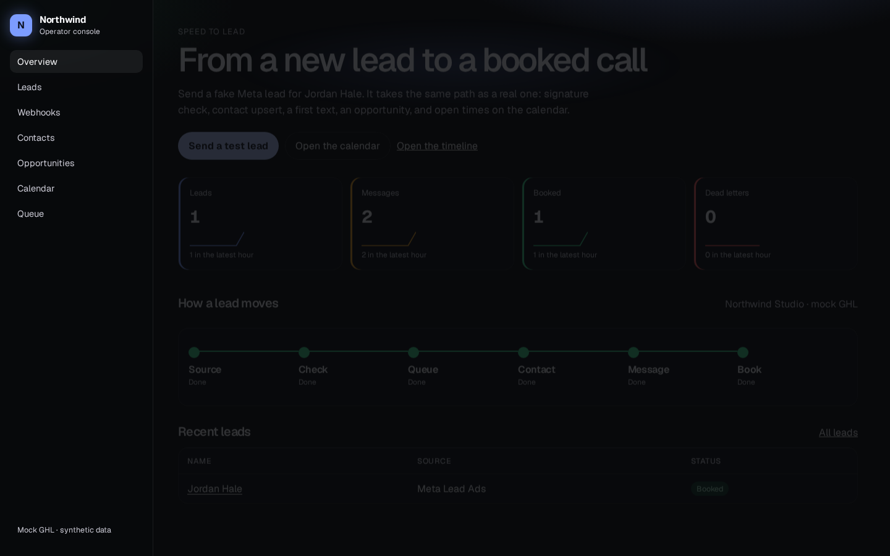
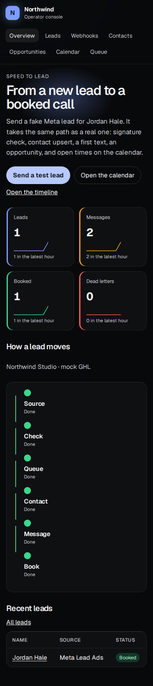
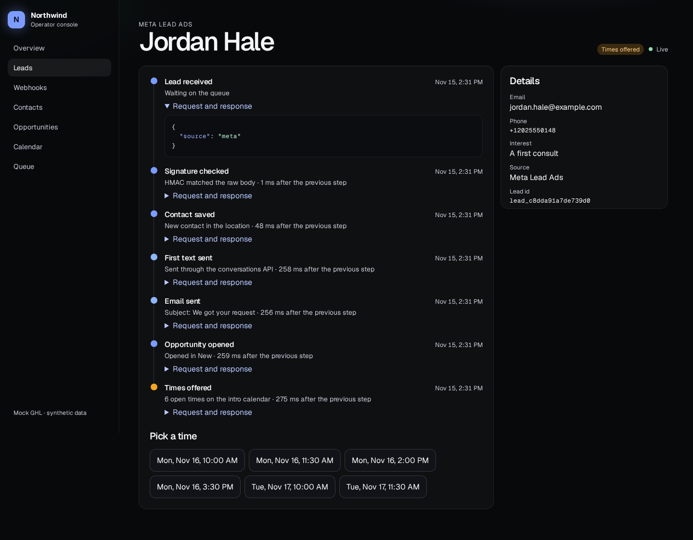
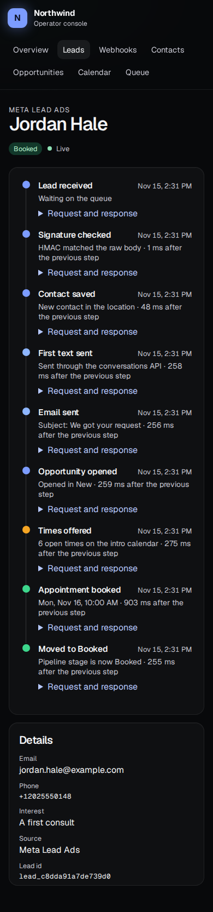
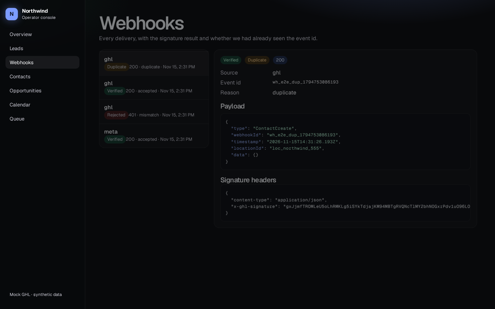
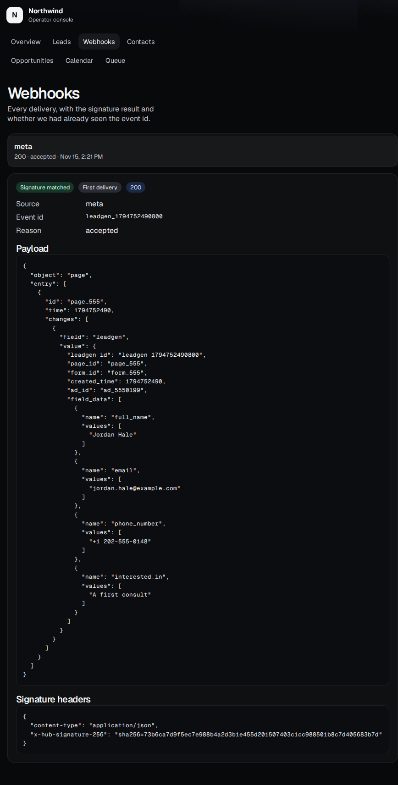
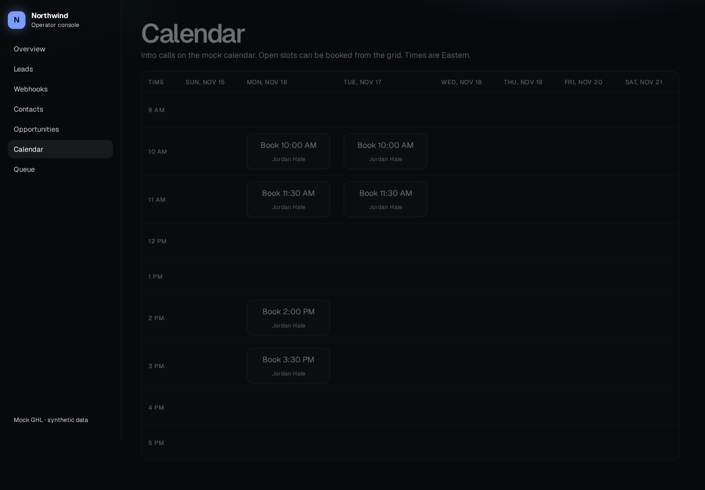
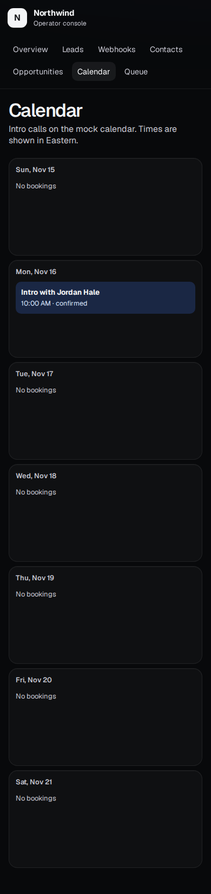

[](https://github.com/mustafaautomation/ghl-integration-kit/actions/workflows/ci.yml)

# ghl-integration-kit

A TypeScript kit for a GoHighLevel Marketplace app: OAuth install, signed webhooks, lead ingest, and a speed-to-lead path that upserts a contact, sends a first text and email, opens an opportunity, and books a calendar slot. It runs against a mock LeadConnector server so you can try the whole path without a GHL account. Point the same process at `https://services.leadconnectorhq.com` when you have a marketplace app.

## Live demo

[https://leadrouter.squishwala.workers.dev](https://leadrouter.squishwala.workers.dev) is the public host for this kit. It serves the API, the operator console, and the mock LeadConnector from one Cloudflare Worker, with D1 for the store and a Cloudflare Queue for jobs. GoHighLevel on that host is the bundled mock. Live mode is for a HighLevel sandbox: set `GHL_MODE=live` and the marketplace credentials. The OAuth redirect is `https://leadrouter.squishwala.workers.dev/api/oauth/callback`, and later `https://leads.quvantic.com/api/oauth/callback`. Deploy steps and the Workers free-plan limits are in [docs/deploy.md](docs/deploy.md). Local Docker Compose is unchanged.

```mermaid
flowchart LR
  meta[Meta Lead Ads]
  form[Website form]
  call[Missed-call webhook]
  api[API]
  queue[SQLite queue]
  pg[(Postgres)]
  ghl[GHL or mock]
  ui[Operator console]
  meta --> api
  form --> api
  call --> api
  api --> pg
  api --> queue
  queue --> ghl
  ui -->|SSE| api
```



## Quick start

```bash
cp .env.example .env
docker compose up --build -d
docker compose ps
```

The console is at http://localhost:3000. The API is at http://localhost:4000. The mock is at http://localhost:4100.

Postgres keeps installs and leads. The queue is a SQLite file on a volume. The mock keeps contacts, opportunities, and appointments in memory, so those views are empty after a mock restart until you send another lead.

## Mock and live mode

`GHL_MODE=mock` is the default. The API talks to the mock, verifies webhooks with the test public keys in `keys/test/`, and on boot installs the sample location if the saved token does not work. `POST /demo/test-lead` and `POST /demo/reset` exist only in this mode.

`GHL_MODE=live` uses `https://services.leadconnectorhq.com` and the OAuth consent screen at `https://marketplace.gohighlevel.com/oauth/chooselocation`. Set `GHL_CLIENT_ID`, `GHL_CLIENT_SECRET`, and `GHL_REDIRECT_URI` from your marketplace app, and set `TOKEN_ENCRYPTION_KEY` to your own 32-byte base64 key. Live mode refuses the demo key from `.env.example`. Webhook checks use the Ed25519 and RSA public keys published in the [webhook guide](https://marketplace.gohighlevel.com/docs/webhook/WebhookIntegrationGuide). Override them with `GHL_ED25519_PUBLIC_KEY` and `GHL_RSA_PUBLIC_KEY` if HighLevel rotates a key. Open `GET /oauth/install` to send a location through consent.

Every LeadConnector call sends `Authorization: Bearer` and `Version: 2021-07-28`. The token request is form-encoded and does not send that version header. Scopes requested by default:

`contacts.readonly`, `contacts.write`, `opportunities.readonly`, `opportunities.write`, `conversations.readonly`, `conversations.write`, `conversations/message.readonly`, `conversations/message.write`, `calendars.readonly`, `calendars.write`, `calendars/events.readonly`, `calendars/events.write`, `locations.readonly`, `locations/customFields.readonly`, `locations/customFields.write`, `locations/tags.readonly`, `locations/tags.write`.

## Endpoints

| Method | Path | What it does |
| --- | --- | --- |
| GET | `/health` | Process is up. |
| GET | `/ready` | Postgres answers. `503` when it does not. |
| GET | `/oauth/install` | Redirect to the consent screen with a `state`. |
| GET | `/oauth/callback` | Check `state`, exchange the code, store encrypted tokens. |
| POST | `/webhooks/ghl` | Verify a GHL webhook. `401` bad signature or stale timestamp. `200` with `duplicate: true` when the event id was already stored. |
| GET | `/webhooks/meta` | Meta `hub.challenge` handshake. `403` when the verify token is wrong. |
| POST | `/webhooks/meta` | Meta leadgen webhook. HMAC `X-Hub-Signature-256`. |
| POST | `/webhooks/forms` | Website form. HMAC `X-Form-Signature`. |
| POST | `/demo/test-lead` | Mock only. Signs a fake Meta lead and posts it to `/webhooks/meta`. |
| POST | `/demo/reset` | Mock only. Clears leads, inspections, and mock CRM rows. |
| GET | `/leads`, `/leads/:id` | Lead list and timeline. |
| POST | `/leads/:id/book` | Book one of the offered slots and move the opportunity. |
| GET | `/inspections` | Webhook inspector rows. |
| GET | `/crm/contacts`, `/crm/opportunities`, `/crm/appointments` | Read-through to GHL or the mock. |
| GET | `/queue` | Recent jobs and the dead-letter list. |
| GET | `/stream` | Server-sent events. Optional `leadId` query. |
| GET | `/stats` | Counts for the console. |

## Environment

| Variable | Role |
| --- | --- |
| `GHL_MODE` | `mock` or `live`. |
| `GHL_BASE_URL` | LeadConnector base. Mock default `http://localhost:4100`. Live `https://services.leadconnectorhq.com`. |
| `GHL_OAUTH_AUTHORIZE_URL` | Browser consent URL. |
| `GHL_CLIENT_ID`, `GHL_CLIENT_SECRET`, `GHL_REDIRECT_URI`, `GHL_USER_TYPE` | Marketplace OAuth client. |
| `GHL_ED25519_PUBLIC_KEY`, `GHL_RSA_PUBLIC_KEY` | Optional PEM overrides for live mode. |
| `TOKEN_ENCRYPTION_KEY` | 32-byte key, base64. AES-256-GCM for stored tokens. |
| `DATABASE_URL` | Postgres connection string. |
| `QUEUE_DB_PATH` | SQLite file for the job queue. |
| `META_VERIFY_TOKEN`, `META_APP_SECRET` | Meta handshake and HMAC. |
| `FORM_WEBHOOK_SECRET` | Website form HMAC. |
| `WEBHOOK_TIMESTAMP_WINDOW_MS` | Replay window. Default 300000. |
| `TOKEN_REFRESH_SKEW_MS` | Refresh this long before expiry. Default 300000. |
| `LOCATION_ID`, `PIPELINE_ID`, `PIPELINE_STAGE_NEW`, `PIPELINE_STAGE_BOOKED`, `CALENDAR_ID` | Where leads are written. |
| `BUSINESS_NAME`, `TIMEZONE` | Copy and slot timezone. Defaults `Northwind Studio`, `America/New_York`. |
| `CONSOLE_ORIGIN` | Allowed browser origin. |
| `FIELD_MAP_PATH`, `CUSTOM_FIELD_IDS_PATH` | Source field map and GHL custom field ids. |
| `QUEUE_MAX_ATTEMPTS`, `QUEUE_BASE_BACKOFF_MS`, `QUEUE_MAX_BACKOFF_MS`, `QUEUE_JITTER_RATIO`, `QUEUE_POLL_MS` | Retry policy. |
| `DEMO_STEP_DELAY_MS` | Pause between speed-to-lead steps so the console can show them. Default 0. |
| `NEXT_PUBLIC_API_BASE` | Console's API origin. Baked in at `next build`. |

## Webhooks, replay, and duplicates

GHL signs the raw body. This kit checks those bytes and does not re-serialize JSON. If `X-GHL-Signature` is present it is checked with the Ed25519 public key (`crypto.verify` with a null algorithm, base64 signature). If that header is missing, `X-WH-Signature` is checked with RSA-SHA256. A failed check is stored in `webhook_inspections` with `signature_valid = false` and answered with `401`.

`timestamp` on the JSON body has to fall inside `WEBHOOK_TIMESTAMP_WINDOW_MS`, with 60 seconds of future skew. Outside that window the response is `401` and `reason` is `stale` or `future`. A captured body cannot be posted again later.

`webhookId` is inserted into `webhook_events`. The unique key makes the second delivery a duplicate: the handler returns `200` and `{ "duplicate": true }` and does not enqueue another job. Meta uses `meta:<leadgen_id>`. Forms use `form:<id>`.

Meta also answers `GET /webhooks/meta` when `hub.mode=subscribe` and `hub.verify_token` matches, and checks `X-Hub-Signature-256` on `POST`. Forms check `X-Form-Signature: sha256=<hex>` over the raw body and use `submittedAt` for the same timestamp window.

A missed-call shape (`InboundCall` or `CallStatus` with a missed / no-answer / voicemail status, or `InboundMessage` with `messageType: CALL`) upserts the caller and sends one text. It does not place or answer a call. `UNINSTALL` marks the location uninstalled so later API calls stop.

## Queue

Outbound GHL calls run on a SQLite queue (`better-sqlite3`), not BullMQ. The kit does not need a second broker: jobs have to survive a process restart, wait out a `Retry-After`, and land in a dead-letter status the console can query. SQLite does that in one file, tests use a temp file, and Compose stays at Postgres plus the three app processes. A multi-node deploy would swap the queue for BullMQ without renaming the jobs (`speed-to-lead`, `book-appointment`, `missed-call`).

Failed attempts use exponential backoff plus jitter, capped by `QUEUE_MAX_BACKOFF_MS`. A `429` uses `Retry-After` as the floor and still adds jitter, even when that delay is longer than the cap. After `QUEUE_MAX_ATTEMPTS` the row is `dead`. `POST /queue/:id/replay` puts a dead job back to `pending` with its attempts cleared. Rows left `active` by a crash go back to `pending` on startup. Logs are pino JSON. Token fields and signature headers are redacted. Each lead's id is the correlation id on the log line and the job.

## Field map

`config/field-map.json` maps source field names onto `firstName`, `lastName`, `name`, `email`, `phone`, or a custom field key. `config/custom-field-ids.json` turns that key into the GHL custom field id sent as `{ "id", "field_value" }`. Phone numbers go through libphonenumber-js and are stored as E.164. Sample numbers use the fictional US `555-01xx` range, such as `+1 202-555-0148`.

The same email or phone does not get a second first text while an opportunity is still open. The contact is still upserted. The timeline says the person is already in the pipeline.

## Add your own adapter in 5 steps

`CrmAdapter` is the outbound surface: `upsertContact`, `sendMessage`, `createOpportunity`, `updateOpportunityStage`, `getFreeSlots`, `bookAppointment`. `GhlAdapter` speaks LeadConnector. `RestCrmAdapter` posts the same inputs to a small JSON API (`POST /contacts`, `POST /messages`, `POST /opportunities`, `PATCH /opportunities/:id`, `GET /calendars/:id/free-slots`, `POST /appointments`). `HubSpotStubAdapter` is a stub: it does not call HubSpot. It keeps rows in memory so the contract test has a third implementation. The class comment says so.

1. Add a class that implements `CrmAdapter` in `packages/domain/src/adapters/`. Set `name` and `stub`.
2. Map `ContactInput` and the other input types onto that vendor's request bodies. Keep vendor field names inside the class.
3. Return the record types from `packages/domain/src/adapters/types.ts`. Upsert should return the same id when the email already exists, with `isNew: false`.
4. Add the class to `packages/domain/src/adapters/contract.test.ts` by calling `assertCrmAdapterContract`. That test creates a contact, updates it, sends SMS and email, opens an opportunity, moves the stage, reads slots, and books one.
5. Construct it where `buildServer` builds `GhlAdapter` if this vendor should run the speed-to-lead flow. Pass `getToken` or whatever credential the vendor needs from the environment, not from source.

## Tests

Counts below are from this workspace on 15 Nov 2026.

| Command | Result |
| --- | --- |
| `npm run test:unit` | 73 tests, 16 files. Domain line coverage **98.12%** (1,572 / 1,602 lines). Statements 98.12%, functions 98.41%, branches 80.28%. |
| `npm run test:contract` | 6 tests, 2 files. Three of those rerun the adapter contract from the unit run. The other three hit the mock over HTTP and check the responses against the fixtures in `fixtures/ghl/`. |
| `npm run test:integration` | 8 tests, 1 file. Boots the mock and the API against Postgres. Covers the speed-to-lead path, a bad signature, a stale timestamp, a duplicate event, a form lead, a missed call, an expired token refresh, an invalid Meta verify token, a 429 that waits for `Retry-After`, and uninstall. |
| `npm run test:e2e` | 19 Playwright tests. Axe on every console page at desktop and mobile widths, navigation and the empty state, a lead watched through to Booked, booking from the calendar, a rejected signature, a duplicate webhook, and a dead-letter job that is replayed. |

Vitest fails the unit run when domain lines drop under 85%, statements under 85%, functions under 80%, or branches under 75%. CI runs lint, typecheck, unit, contract, integration (Postgres service), Playwright (HTML report and traces uploaded), and `docker compose build`. None of those jobs set `continue-on-error`.

## Console

A test lead moving through the pipeline:

[demo-lead.webm](docs/demo-lead.webm)



















Fonts are Geist and Geist Mono from `@fontsource-variable`, shipped in the bundle. The page does not request Google Fonts at build time.

## Limits

- The mock is not HighLevel. It covers the OAuth token endpoint, contact upsert, conversations messages, opportunities, free slots, and appointment create, with the response fields this kit reads. It does not cover workflows, invoices, users, or snapshots. Its CRM data is in memory.
- Live webhook public keys are the ones in the marketplace guide as of this writing. HighLevel rotates them. Set the env overrides when that happens.
- `HubSpotStubAdapter` does not call HubSpot.
- `RestCrmAdapter` is a shape, not a vendor integration.
- SMS and email are API calls. Nothing is delivered to a handset or an inbox.
- The missed-call path is a webhook in and a text out. There is no dialer and no voice agent.
- The queue is one process and one SQLite file.
- Custom field ids come from the config file. The kit does not read the location's field catalog.
- The console has no login. Do not put it on the public internet.
- Sample people and numbers are fake. Jordan Hale, Priya Shah, and Sam Okonkwo are not customers.
